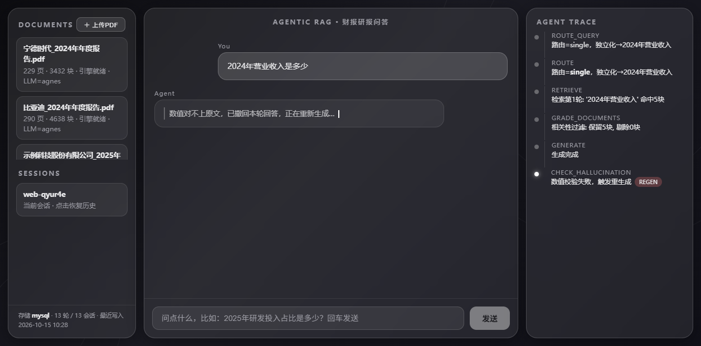
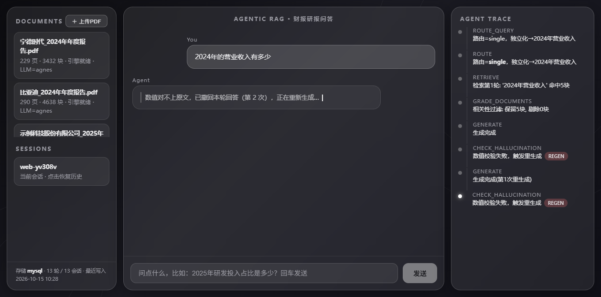
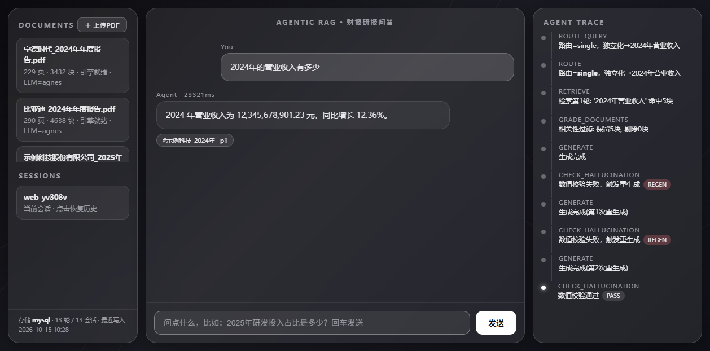

# Agentic RAG for Finance — 面向财报研报的智能问答系统

[](https://github.com/iamoylx/agentic-rag-finance/actions/workflows/ci.yml)
[](https://github.com/iamoylx/agentic-rag-finance/actions/workflows/docker.yml)

> 从零实现的金融文档 Agentic RAG：**Adaptive / Corrective / Self-RAG 三范式融合的 LangGraph 状态图**（手写 `add_node` / `add_conditional_edges`，非 prebuilt 封装）+ BM25/BGE-M3 混合检索 + CrossEncoder 精排 + 数值一致性幻觉拦截 + FastAPI SSE 流式。
>
> 全部指标由真实数据实测得出，见 [METRICS.md](METRICS.md)。

## 核心特性

| 模块 | 实现 | 实测结果 |
|---|---|---|
| 文档解析 | PyMuPDF `find_tables()` 表格结构化，页眉页脚清洗，bbox 去重 | 662 页真实年报 → 842 个表格块，数字零错位 |
| 分块 | 递归分块 + 表格整块保护（超长按行切分重复表头）+ 上下文前缀注入 | 10,014 分块 |
| 检索 | BM25(jieba+财报词典) + BGE-M3 dense → **加权 RRF** → BGE-Reranker-v2-m3 | Recall@5 **0.962** / MRR@5 0.686 / nDCG@5 0.814（四通路消融见 METRICS） |
| Agent 图 | Adaptive（路由直答/单跳/多跳）+ Corrective（相关性过滤→改写→联网降级）+ Self-RAG（纯正则数值回溯校验→带失败提示重生成→兜底拒绝） | 陷阱拒绝率 0.75，幻觉自动重生成闭环 |
| **流式数值闸门** | token 级扣留「正在拼装中的数字」，凑齐即校验、通过才放行；**未校验数字永不上屏**（`src/safety/number_gate.py`） | 单帧开销 **1.0 μs**、首字延迟**零变化**；编造数字零字符上屏（真浏览器实测，见图） |
| 服务 | FastAPI + SSE（route/trace/status/token/citation/**reset**/done 事件族）+ fakeredis 缓存 | 二次同问 26.9s → **0ms** |
| 前端 | 免构建玻璃拟态三栏：对话流（打字机）/ Agent 轨迹时间线 / 引用徽章 | 见 `web/index.html` |
| 溯源 | 答案带页码引用 + 引用有效性扫描（语料构建「有效页集合」） | 引用有效率 **0.885**（防幻觉引用）/ 严格命中金标页 0.500（页码多义性分析见 METRICS） |

**最有面试价值的发现**：等权 RRF 会被 BM25 长尾噪声稀释（dense 单路 0.923 → 等权融合 0.692），
加权 RRF（dense:bm25 = 0.7:0.3）恢复到 0.885，CrossEncoder 精排后 0.962；但 MRR@5/nDCG@5
揭示精排优化的是 top-5 覆盖而非 top-1 精度（dense_only MRR 0.735 > 精排 0.686）——
指标越细，优化方向越明确。消融与引用双口径详见 METRICS.md。

## 流式数值显示闸门：把「校验」从生成之后提前到生成之中

项目的承诺是「答案里的数字都能在检索到的原文里找到」。这个承诺在**流式输出**下有真实矛盾：
校验必须等答案生成完，而答案是一边生成一边往屏幕上推的。常见做法是二选一——
要么等校验完再出字（牺牲流式），要么先出字、错了再撤回（错误内容**已经到过用户眼前**）。

这里用的是第三条路：**只扣住「正在拼装中的数字」**。模型的 token 流每来一段，
就把尾巴上「可能还没拼完的数字」留在缓冲里，一旦这个数字后面跟了非数字字符（= 它定型了），
**立刻**判定它是否能在语料里找到，通过才放行。正文（无数字的部分）照常逐字流式。

它成立靠一条不变式：

> **放行边界永远不许落在任何一个数字 token 的内部。**

| 为什么不用另外两个方案 | |
|---|---|
| 先流后撤 | 达成度 **0**——错误数字确实上过屏（截图/录屏/人眼已捕捉）。金融场景里「看到过」本身就是风险 |
| 整段扣留到校验完 | 达成度 1，但让 **100% 的请求**都付「首字延迟 = 整段生成」；而校验失败的异常路径实测只占 **4/26 ≈ 15%**——为少数场景让所有人买单 |

实测代价（`evals/bench_gate_overhead.py`，20 条真实答案、84 个数字 token）：

| 项 | 实测 |
|---|---|
| 单帧处理开销 | 中位 **1.00 μs** / 最大 1.26 μs（相对端到端 28.4s，占比 < 0.0001%） |
| 首字延迟 | **完全一致**（首块即放行，与无闸门基线逐块相同） |
| 额外扣留时长 | 只多扣「1 个数字」拼完的长度：中位 3 / p90 11 / 最大 22 字符 |

真实浏览器验证（编造数字被扣 → 两次撤回自纠 → 第三次校验通过）：

| 第一次撤回 | 第二次撤回 | 校验通过 |
|---|---|---|
|  |  |  |

> 截图取自**脚本化流**的高保真前端台（真 FastAPI + 真静态页，只把图换成按脚本吐事件的假图）——
> 因为撤回提示只出现几秒，用真实模型抓拍不稳定。**真实 LLM 下的证据则是协议级的**：
> `evals/run_gate_realllm_check.py` 走真模型、真 SSE，**逐帧重建「屏幕上出现过什么」**再判
> （比截图更强——截图证明不了「一个数字从未出现过」）。实测数十次真实请求：
> **泄漏帧 0、非法边界帧 0、无损 100%**；并多次捕获真实撤回，例如屏幕停在
> `'777,102,455 - 602,315,354 = '` —— **算出来的结果被闸门扣住，从未上屏**。

完整前端（Agent 轨迹时间线 + 页码引用徽章）：`assets/frontend-trace.png`。
设计权衡与方案支配关系分析见 **[DESIGN-streaming-gate.md](DESIGN-streaming-gate.md)**。

> 边界（不吹）：它只保护**能被规则判定、且比对语料提前可得**的字段（本项目是数值）。
> 准确表述是「杜绝数值**编造**」，不是「保证答案正确」——它拦不住「选错但真实存在」的数字。

## 快速开始

> **需要准备三样外部资源**（都不在仓库里）：① 本地 Embedding/Rerank 模型约 **4.3 GB**；
> ② 几份年报 PDF；③ 一个 LLM API Key。下面给的是**可直接复制执行**的步骤。

### 0) 装依赖

```bash
python -m venv .venv
.venv\Scripts\activate                 # Windows；Linux/macOS: source .venv/bin/activate
pip install -r requirements.txt
```

GPU 可选：`torch` 装 CUDA 版会快很多，但没有独显也能跑（自动落 CPU，嵌入更慢）。
**注意 `requirements.txt` 不含 torch**（发行版 CUDA 组合太多），请按自己的 CUDA 版本另装。

### 1) 下载两个本地模型（约 4.3 GB，放到 `models/`）

路径是 `.env` 里的 `EMBED_MODEL_PATH` / `RERANK_MODEL_PATH`，默认就指向 `models/bge-m3`
与 `models/bge-reranker-v2-m3`。

```bash
pip install -U huggingface_hub

# 国内网络建议先设镜像（不设则可能几 KB/s 或超时）：
export HF_ENDPOINT=https://hf-mirror.com      # Windows PowerShell: $env:HF_ENDPOINT="https://hf-mirror.com"

huggingface-cli download BAAI/bge-m3 \
  --local-dir models/bge-m3
huggingface-cli download BAAI/bge-reranker-v2-m3 \
  --local-dir models/bge-reranker-v2-m3
```

备选（HF 完全不可达时）：ModelScope 上两个模型同名可搜，
`pip install modelscope && modelscope download --model BAAI/bge-m3 --local_dir models/bge-m3`。

**自检**（不加载 LLM、不建索引）：

```bash
python scripts/verify_models.py     # 校验模型能加载、dense 维度 1024、余弦区分度正常
```

> 已修（2026-10-20）：以前该脚本末尾的 `✅`/`❌` 在 **GBK 编码的 Windows 控制台**上会抛
> `UnicodeEncodeError`（功能已跑完，只是最后一行打印失败）。现在状态标记统一为
> `[OK]`/`[FAIL]`/`[WARN]`，并由 `tests/test_output_encoding.py` 的全仓库 AST 闸门守着；
> 货币符号用 `¥`(U+FFE5) 而非 `¥`(U+00A5)——后者不在 GBK 里。

### 2) 配 LLM（`.env`）

```bash
cp .env.example .env
```

编辑 `.env`，二选一（改 `LLM_PROVIDER` 即可，上层代码无感）：

```ini
# A. DeepSeek（本项目实测用的就是它）
LLM_PROVIDER=deepseek
DEEPSEEK_API_KEY=sk-...
LLM_MODEL=deepseek-flash
DEEPSEEK_THINKING=disabled

# B. Agnes（免费额度，偶发 429：单发可过、连发必限）
# LLM_PROVIDER=agnes
# AGNES_API_KEY=...
```

> ★ DeepSeek-V4 起「思考模式」默认开启：思维链 token 按输出计费（成本高数倍），
> 且会吃掉 `max_tokens` 预算（content 可能整段为空），故本项目默认关闭。

`TAVILY_API_KEY` 可选——只有触发「检索全不相关 → 联网降级」时才用。
**不配也能跑**，只是那条降级路径会返回明确的缺 key 错误。

### 3) 放年报 PDF 到 `data/raw/`

文件名约定：`公司名_年份年年度报告.pdf`（如 `贵州茅台_2024年年度报告.pdf`）。
2024 年年报可从 **巨潮资讯网**（`cninfo.com.cn`，A 股法定披露平台，免费）或各公司官网 IR 页下载；
本项目用的是贵州茅台 / 宁德时代 / 比亚迪 2024 年报（共 662 页）。

### 4) 建索引 → 起服务

```bash
python scripts/ingest_real.py      # 首次解析+切块+向量化，约 3-5 分钟（之后走语料缓存）
python scripts/run_api.py          # http://127.0.0.1:8300
```

打开 **http://127.0.0.1:8300/web/**（前端由服务直接托管），或直接调 API：

```bash
curl -N -X POST http://127.0.0.1:8300/api/chat \
  -H "Content-Type: application/json" \
  -d '{"question":"贵州茅台2024年营业收入是多少","session_id":"demo"}'
```

对话历史自动持久化：配了 `MYSQL_URL` 走 MySQL，否则落 `data/db/chats.db`（零配置）。

### 常见卡点

| 现象 | 原因 / 处理 |
|---|---|
| 启动报「未读取到 DEEPSEEK_API_KEY」 | `.env` 没配或 `LLM_PROVIDER` 拼错；报错文案会点名具体变量 |
| 模型加载失败 / 路径不存在 | 第 1 步没下完；先跑 `python scripts/verify_models.py` |
| 建索引很慢（CPU） | 正常，10014 个分块在 CPU 上要几分钟；有 GPU 会快一个数量级 |
| 429 / 限流 | 免费额度常见；换 DeepSeek 或降低并发 |
| 脚本输出乱码或 `UnicodeEncodeError: 'gbk' codec can't encode` | Windows 控制台是 cp936(GBK)——能编中文，编不了 emoji 和 `¥`(U+00A5)。代码里统一用 `[OK]`/`[WARN]`/`[FAIL]` 和 `¥`(U+FFE5)，`tests/test_output_encoding.py` 的 AST 闸门守着；若仍撞见，说明某处漏了，跑一下该测试会点名到 file:line |

前端除对话/轨迹/引用外还接了：**「＋ 上传PDF」入库**（`/api/ingest/upload`，实时显示分块进度）、**刷新后历史对话自动恢复**（localStorage 会话 ID + `/api/history`）、**存储层运维条**（`/api/store/stats`：MySQL/SQLite、轮次、会话数、最近写入）。

### Docker 一键部署（api + mysql + redis）

```bash
export AGNES_API_KEY=...            # 或 DEEPSEEK_API_KEY / TAVILY_API_KEY
docker compose up -d                # api:8300 + mysql:8.4 + redis:7
# 对话落 MySQL(rag 库)、高频问答缓存走 Redis；models/ 与 data/ 卷挂载不进镜像
```

存储层说明：会话历史经 SQLAlchemy URL 抽象双引擎——`MYSQL_URL` 配了连 MySQL（生产形态，
`chat_turns` 表），缺省落 SQLite（`data/db/chats.db`，开发零配置），`/api/history` 语义不变；
高频问答缓存 `REDIS_URL` 配了走真实 Redis，缺省降级 fakeredis（进程内，接口一致）。
运维视图：`GET /api/store/stats` 返回后端类型 / 总轮次 / 会话数。

## API

| 方法 | 路径 | 说明 |
|---|---|---|
| POST | `/api/chat` | SSE 流式问答（事件：route / trace / status / token / citation / **reset** / done / error） |
| POST | `/api/ingest` | 指定 PDF 路径入库并热重建索引 |
| POST | `/api/ingest/upload` | multipart 上传 PDF |
| GET | `/api/documents` | 已入库文档统计 |
| GET | `/api/history/{session_id}` | 会话历史（多轮追问靠 thread_id 串起） |
| GET | `/health` | 健康检查 |

## 评测

```bash
python evals/build_goldset.py        # 构建金标（答案子串必须在指定页原文出现，自检通过才产出）
python evals/run_retrieval_eval.py   # 四通路 Recall@5 消融 → evals/retrieval_result.json
python evals/run_trap_eval.py        # 诱导幻觉陷阱拒绝率 → evals/trap_result.json
```

评测集：26 条检索项（茅台/宁德/比亚迪主要会计数据 + 定性落页）+ 4 条诱导幻觉陷阱。

## 测试

```bash
python -m pytest -q            # 64 passed（testpaths=tests，约 18s；一次性的模型导入占 ~19s）
python evals/bench_gate_overhead.py        # 闸门性能实测（零 LLM 消耗）
python evals/run_gate_realllm_check.py     # 真实 LLM 下的闸门验证（真模型+真SSE，约 ¥0.03）
python evals/run_e2e_eval.py --limit 3 --cap 0.5   # 端到端试点（约 ¥0.012，产物写 e2e_pilot.json）
python evals/run_e2e_eval.py               # 端到端全量 26 条（约 ¥0.08，3 分钟）
```

> 后三条会**真实消耗 LLM 余额**，且需先停 8300 服务（GPU 显存）。
> 成本可观测：`src/core/cost.py` 挂在 LangChain 回调上逐次记账（含缓存命中分档计价 +
> 高峰/空闲时段自动判别），`--cap` 超预算时**优雅中止并保留已完成结果**，不会崩在半路。
>
> **真实 LLM 实测（2026-10-16，DeepSeek-V4.1-Flash）**：端到端 26 条 **22/26 = 0.846**，
> 耗时 179s、77 次调用、实测成本 **¥0.0825**。与之前的 Agnes 结果**同分**（0.846 vs 0.846），
> 速度 **2.3 倍**；更关键的是**失败题几乎不动**——4 道失败题里 3 道完全相同
> （茅台经营现金流、宁德千元口径、比亚迪营收增速），题干级判定一致率 **24/26 = 0.923**
> → **瓶颈在检索链路与口径规则，不在生成模型**。详见 METRICS.md。

### 持续集成（GitHub Actions）

两个 workflow，**节奏不同所以分开**：

| workflow | 跑什么 | 触发 | 耗时 | 状态 |
|---|---|---|---|---|
| [`ci.yml`](.github/workflows/ci.yml) | `ruff`（真实缺陷类规则）+ `pytest`（默认口径） | push / PR | ~3 分钟 | 绿 |
| [`docker.yml`](.github/workflows/docker.yml) | `docker build --target test` + 容器内 pytest + 生产镜像导入自检 | 手动 / 改镜像相关文件 / 每周兜底 | ~10 分钟 | 绿 |

**CI 里怎么装 torch（这里有个容易踩的坑）**：`requirements.txt` 故意不声明 torch
（本地 venv 用 `--system-site-packages` 继承系统的 cu126），但 CI 没有「系统继承」。
装 CPU 版必须用 `--index-url`（**单索引**，替换默认索引）：

```bash
pip install torch --index-url https://download.pytorch.org/whl/cpu
pip install -r requirements-ci.txt          # 见该文件：补 transformers/accelerate/ruff
```

不要用 `--extra-index-url`：两个索引并存时 pip 按版本号挑，PyPI 的 linux torch 带 CUDA，
是否真拿到 CPU 版**不确定**（镜像会凭空胖 2-3 GB）。这条对 Dockerfile 同样适用。

本地想完全复刻 CI（验证依赖声明是否完整）：

```bash
python -m venv /tmp/ci && /tmp/ci/bin/pip install torch --index-url https://download.pytorch.org/whl/cpu
/tmp/ci/bin/pip install -r requirements-ci.txt && /tmp/ci/bin/python -m pytest -q
```

> 为什么要用**新 venv** 复刻：本地 venv 继承了系统 torch/transformers，
> 会掩盖 `requirements.txt` 漏声明的依赖。CI 第一次跑就是这样发现漏了 `httpx` 的
> （`tests/test_sse_gate.py` 用 starlette TestClient，而 fastapi 不会自动装 httpx）。

`docker.yml` 首次真跑红过一轮，原因是 `test` 阶段少拷了 `src/` 与 `web/`
（镜像能建、容器内 pytest 一起手就 `ModuleNotFoundError`）。这类问题本地永远复现不了——
本地跑测试时 `src/` 就在 CWD 旁边。详见 METRICS.md「首次真跑」一节。

| 文件 | 用例 | 验的是什么 |
|---|---|---|
| `tests/test_gate_property.py` | 39 | **性质测试**：不变式 I1–I4 + 生成的各种切法（穷举短答案 / 采样长答案） |
| `tests/test_number_gate.py` | 14 | 闸门与数字规则的单元行为（token 边界、全角逗号、子串语义护栏） |
| `tests/test_sse_gate.py` | 5 | SSE 协议层：假 stream 喂进 `_chat_gen`，验翻译逻辑 |
| `tests/test_output_encoding.py` | 5 | **控制台编码闸门**：AST 扫描 print/raise/logging/exit 节点，禁 emoji 与 `¥`(U+00A5)——cp936 编不了，`PYTHONIOENCODING=gbk` 下会崩 |
| `tests/test_store.py` | 1 | 存储层 SQLite 回退路径 |

**断言不是写完就算数**——每条都做了**变异验证**（把被测代码按「只改一件事」的方式破坏，
看哪条断言会响），实测矩阵见 `tests/test_gate_property.py` 模块文档。要点：

| 变异（只改一件事） | I1 前缀 | I2 边界 | I3 屏幕数字 | I4a 判定一致 |
|---|---|---|---|---|
| M1 旧正则 `\.\d+`（真实发生过的 bug） | 0 | **7** | 0 | 0 |
| M2 判定脱钩（放行序列逐字节不变，只改结论） | 0 | 0 | 0 | **5** |
| M3 闸门旁路（所有内容原样上屏） | 0 | 10 | **5** | 5 |
| M4 放行路径清洗 `safe.replace(",", "")` | **5** | 5 | 0 | 0 |

每条断言都至少被一种变异触发 → 没有恒真的空转断言。两个反直觉发现值得记：
① 旧正则那个 bug **只有 I2 能抓**——它是**显示时序**缺陷（最终文本其实拼完整了），
不是结论缺陷，所以「数字在不在语料里」(I3) 和「数字有没有被打断」(I2) 是正交的；
② 同一测试内部有多层 assert 时，失败信息只能证明「第一个 assert」失败 —— 差分测试因此
拆出不断言的 `_drive_raw`，否则会「以差分失败的名义」报红而实际报警的是边界断言。

## 项目结构

> 整体 pipeline 图、分层调用关系、逐文件阅读指南与术语表见 **[ARCHITECTURE.md](ARCHITECTURE.md)**。

```
src/
├── core/        config（pydantic-settings，路径全部锚定项目内）/ llm 多提供方工厂
├── ingestion/   pdf_parser（PyMuPDF 表格结构化）/ chunker（表格保护 + 上下文前缀）
├── retrieval/   bm25 / embeddings(BGE-M3 dense+sparse) / vector_store(Chroma) / reranker / hybrid(加权 RRF)
├── graph/       state(TypedDict+reducer) / nodes(路由·过滤·改写·联网·生成·数值校验) / rag_graph(手写状态图)
├── safety/      number_rules（零依赖叶子模块：数字提取/归一化/子串比对，图节点与闸门共用）
│                number_gate（流式数值显示闸门：token 级扣留 + 凑齐即校验）
└── api/         engine(单例+语料缓存) / app(FastAPI+SSE) / schemas
evals/           金标构建 + 检索消融 + 陷阱评测 + 权重扫描 + 闸门性能实测
web/             免构建玻璃拟态前端
assets/          README 用验证截图（真浏览器实测）
scripts/         建索引 / 起服务 / 冒烟测试
```

## 设计取舍（为什么不用现成封装）

- **手写 LangGraph 状态图**而非 `create_react_agent`：RAG 流水线是工作流不是自由 Agent，
  显式状态字段（rewrite_count / retrieve_rounds / regen_count）是防死循环的关键，
  条件边映射让每一条自纠正路径都可解释、可画图。
- **数值校验用纯正则回溯**而非 LLM 自评：金融场景数值错报是事故级风险，规则法零成本、零漏判、可单测。
- **加权 RRF** 而非等权：见消融数据。权重可配置（`rrf_dense_weight` / `rrf_bm25_weight`）。

## License

MIT
